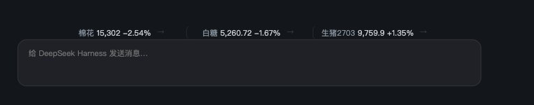

# 行情带（dsh-futures-ribbon）

DSH（DeepSeek Harness）插件：在输入框上方注入一条**极轻的单行期货行情**，点击展开明细浮层；
也可以切换成**左侧栏底部的小面板**（向上滚动）。数据来自新浪财经。



单色设计（不用红绿）、格子等宽、逐个切换；**休市不显示、不拉取**，不打扰日常对话。

- 版本：`0.1.0`
- 依赖：DSH `0.2.1-rc.3` 及以上（桌面版或 Web 版均可）
- 许可：[MIT](LICENSE)

## 特性

- **极轻的一行**：与输入框同宽、居中、无标签，用宿主次级文字色，不抢注意力
- **格子等宽、格数自适应**：格宽由当前自选里最长的合约名决定，窗口变宽自动多显示一格
- **两个维度**：当日涨跌用 `+/-`；其右侧的 `↑↓` 表示"较上次刷新"的变化量级，按合约自身波动自适应
- **交易时段感知**：按品种判断是否开市，休市与小休不去上游拉取，箭头也随之留空
- **点击看明细**：迷你分时 + TRIX 双线图 + 多空判断 + 开高低 / 持仓 / 成交量 / 均线排列
- **两种显示方式**：输入框上方（默认） / 左侧栏底部（向上滚动）
- **设置齐全**：搜索添加（主连优先、支持具体月份）、拖动排序、刷新与切换间隔、切换动效、恢复默认（二次确认）

## 安装

```bash
CLI="/Applications/DeepSeek Harness.app/Contents/Resources/runtime/cli/bin/dsh"

# 从 GitHub 安装
"$CLI" plugin --profile desktop add codeway3/dsh-futures-ribbon
```

也可以装本地目录（开发调试用）：

```bash
"$CLI" plugin --profile desktop add /path/to/dsh-futures-ribbon
```

装完 **⌘Q 退出并重新打开 DSH**（宿主半需要重启加载）。之后前端改动只需 ⌘R 刷新窗口。

确认加载成功：

```bash
curl -s "http://127.0.0.1:<GUI端口>/futures-ribbon/api?op=health"
# {"ok":true,"op":"health","catalog":82,"version":"0.1.0"}
```

GUI 端口每次启动可能变化，以 DSH 启动时输出的 URL 为准。

卸载：

```bash
"$CLI" plugin --profile desktop remove dsh-futures-ribbon
```

## 使用

### 行情带怎么读

```
生猪2703  9,759.9  +1.35%  ↑↑
└ 名称     └ 最新价  └ 当日涨跌  └ 较上次刷新的变化量级
```

| 元素 | 含义 |
|---|---|
| `+1.35%` / `-0.72%` | 当日涨跌幅（相对昨结算），正负用 `+` / `-` |
| `↑` `↑↑` `↑↑↑` | 相对**上一次刷新**上涨，箭头数量表示幅度大小 |
| `↓` `↓↓` `↓↓↓` | 相对上一次刷新下跌 |
| `→` | 交易中，但本次刷新价格几乎没变（低于最小阈值） |
| **空白** | 该合约**不在交易时段**（休市 / 小休 / 未开盘），此时也不拉取行情 |

量级按每个合约自身的典型跳动自适应：`ratio = 本次相对幅度 ÷ 该合约近期典型跳动`，
`≥1 → 1 个`、`≥2.5 → 2 个`、`≥5 → 3 个`；3 个箭头会用琥珀色加粗强调（只表示幅度，不表示涨跌方向）。

### 明细浮层

点击任意格子，在行情带上方展开详情：

- 价格迷你走势图
- **TRIX 双线图**（TRIX 实线 / 信号线 / 零轴虚线 / 末端点）+ `TRIX 判断（多 / 空 / 中性）` + `TRIX12 / 信号` 数值
- 开盘 / 最高 / 最低、持仓量 / 成交量、均线排列（MA5 / MA10 / MA20 / MA60）、交易日
- 表格列出全部自选，点行可切换品种

浮层只在你点击 `✕` 或按 `Esc` 时关闭，不会因为鼠标移开而消失。

### 快捷键

| 快捷键 | 作用 |
|---|---|
| `Cmd+Shift+F`（Windows/Linux `Ctrl+Shift+F`） | 隐藏 / 恢复行情带 |
| `Esc` | 关闭明细浮层 |

## 设置

入口：**DSH 设置 → 行情带**

| 配置项 | 默认值 | 说明 |
|---|---|---|
| 自选 | 天然橡胶、棉花、白糖、豆粕、棕榈油、铁矿石、鸡蛋、铜、黄金、生猪（主连） | 搜索添加；按住芯片拖动即可排序 |
| 显示方式 | 输入框上方 | 或「左侧栏底部（向上滚动）」 |
| 刷新间隔 | 5 秒 | 只在交易时段按此频率；小休/午休 2 分钟、全部休市 5 分钟 |
| 切换间隔 | 4 秒 | 每隔多久把**一格**换成队列里下一个未显示的合约；`不切换` = 关闭 |
| 切换动效 | 淡入淡出 | 可选「上滑淡入」「无动效」 |
| 显示状态 | 显示中 | 关闭等同于隐藏 |

搜索支持三种输入：中文名（`生猪`）、品种代码（`LH`）、具体月份（`LH2703` / `LH27`）。
结果排序固定为 **主连 → 指定月份 → 该品种其它已挂牌月份**，未挂牌的月份不会出现。

配置存放在 `localStorage`（键 `dsh-futures-ribbon.config.v1`），多个窗口自动同步。

## 显示方式

**输入框上方（默认）**
注入 `conversation.input.dock`；运行时量出输入框所在盒子（按"圆角 ≥ 8px 的最近祖先"识别）的宽度，行情带取同宽并居中，识别失败时回退 100% 宽。

**左侧栏底部**
注入 `sidebar.footer.action`，`order: -2`（排在消费额度等插件上方）。标题一行 + 约 4 行行情窗口，
超出时内容**向上无缝滚动**（复制两份做 `translateY(-50%)` 衔接，悬停暂停），点击行打开详情。

## 工作原理

```
┌─ 宿主半 index.js ────────────────────────────┐
│ 注册 HTTP 路由 /futures-ribbon/api            │
│   health  版本与目录信息                       │
│   catalog 主连目录（82 个品种）                │
│   quotes  实时快照（只拉开市品种）             │
│   months  某品种已挂牌的月份                   │
│   kline   分钟 / 日 K 线                       │
│ 代理新浪接口：带 Referer、GB18030 解码         │
└───────────────────────────────────────────────┘
                    ↕ fetch
┌─ 客户端半 client.js ──────────────────────────┐
│ conversation.input.dock   行情带               │
│ sidebar.footer.action     左侧栏面板           │
│ settings.section          设置页               │
│ 箭头量级、TRIX、均线 全部本地计算              │
└───────────────────────────────────────────────┘
```

- **数据源**：`hq.sinajs.cn` 实时快照 + `stock2.finance.sina.com.cn` 的分钟 / 日 K 线
- **快照缓存**：宿主侧 3 秒；**K 线缓存**：20 秒
- **交易时段**（按品种）：
  - 商品日盘 `09:00-10:15` / `10:30-11:30` / `13:30-15:00`
  - 中金所股指 `09:30-11:30` / `13:00-15:00`；国债 `09:30-11:30` / `13:00-15:15`
  - 夜盘 `21:00-02:30`（黄金 / 白银 / 原油）、`21:00-01:00`（有色、不锈钢、橡胶、20 号胶、能化部分）、`21:00-23:00`（其余）
  - 无夜盘：全部中金所 + 鸡蛋 / 生猪 / 苹果 / 红枣 / 花生 / 硅铁 / 锰硅等
- **拉取节流**：只对开市品种请求上游；全部休市 5 分钟一次、小休 2 分钟一次、交易中按设置的刷新间隔；
  窗口不可见时降到 15 秒
- **格宽计算**：canvas 精确测量最长合约名 + 最宽价格 + 最宽涨跌幅 + 22px 箭头槽 + 内边距，向上取 4px 整数倍；
  格数 = ⌊(输入框宽 − 12) ÷ 格宽⌋

## 已知限制

- **不识别法定节假日**：节假日会被当作交易日，仍会拉取（数据不变），界面不会误报；
- **交易时段表为人工整理**：新上市品种默认按"21:00-23:00 有夜盘"处理（宁可多拉一次，不会漏行情）；
- **新浪不提供加权合约**（`LC9999` / `LC8888` / `LC000` 等写法均无数据），搜索结果里没有加权项；
- **依赖 DSH 内部插槽**：`conversation.input.dock`、`sidebar.footer.action`、`settings.section`，
  宿主大改版可能导致失效，适配版本见 `package.json` 的 `dsh.compatibility`；
- **宿主半改动需要重启 DSH**，前端改动刷新窗口即可。

## 开发

```sh
# 语法检查 + 合约白名单用例
npm run check

# 连上正在运行的宿主，顺带验证 quotes / months / 中金所字段
node scripts/check-contract-codes.mjs http://127.0.0.1:<GUI端口>

# 用真 React 做 SSR 冒烟（FR_REACT_DIR 指向任意含 react/react-dom 的 node_modules）
FR_REACT_DIR=/path/to/node_modules npm run smoke
FR_MODE=landing FR_REACT_DIR=/path/to/node_modules npm run smoke:landing   # 落地页场景，行情带应产出 0 字符
```

**验证台**（真实组件 + mock 数据，不联网）：

```sh
# preview/vendor 里需能解析到 react / react-dom（该目录不入库，可从 node_modules 复制过来）
python3 -m http.server 8787 --bind 127.0.0.1
open http://127.0.0.1:8787/preview/harness.html
```

**目录结构**

| 路径 | 作用 |
|---|---|
| `index.js` | 宿主半：HTTP 路由、上游代理、交易时段表、缓存 |
| `client.js` | 客户端半：行情带、侧栏面板、设置页、浮层与图表 |
| `cordis.patch.yml` | bundle 层，把本插件插入 profile |
| `data/catalog.json` | 82 个主连合约目录（搜索添加用） |
| `locale/*.json`、`icon.svg` | 宿主里的标题 / 描述 / 图标 |
| `scripts/check-contract-codes.mjs` | 合约白名单用例 + 运行时接口校验 |
| `scripts/render-smoke.cjs` | SSR 冒烟（含落地页隐藏场景） |
| `preview/harness.html` | 开发用验证台 |
| `.github/workflows/ci.yml` | CI：语法 + 用例 + bundle 清单一致性 |

## 数据来源与免责声明

- 行情数据来自**新浪财经**公开接口，本插件只做展示与本地计算，**不是官方行情**，不保证准确性、完整性与实时性
- 交易时段表为人工整理，**不含法定节假日**，交易所临时调整也不会自动感知
- TRIX / 均线等技术指标均为**客户端本地计算**，仅供研究参考，**不构成任何投资建议**；据此操作的盈亏由使用者自行承担
- 请勿高频轮询上游接口：本插件默认交易中 5 秒一次，休市最长 5 分钟一次

## License

[MIT](LICENSE) © 2026 [codeway3](https://github.com/codeway3)
